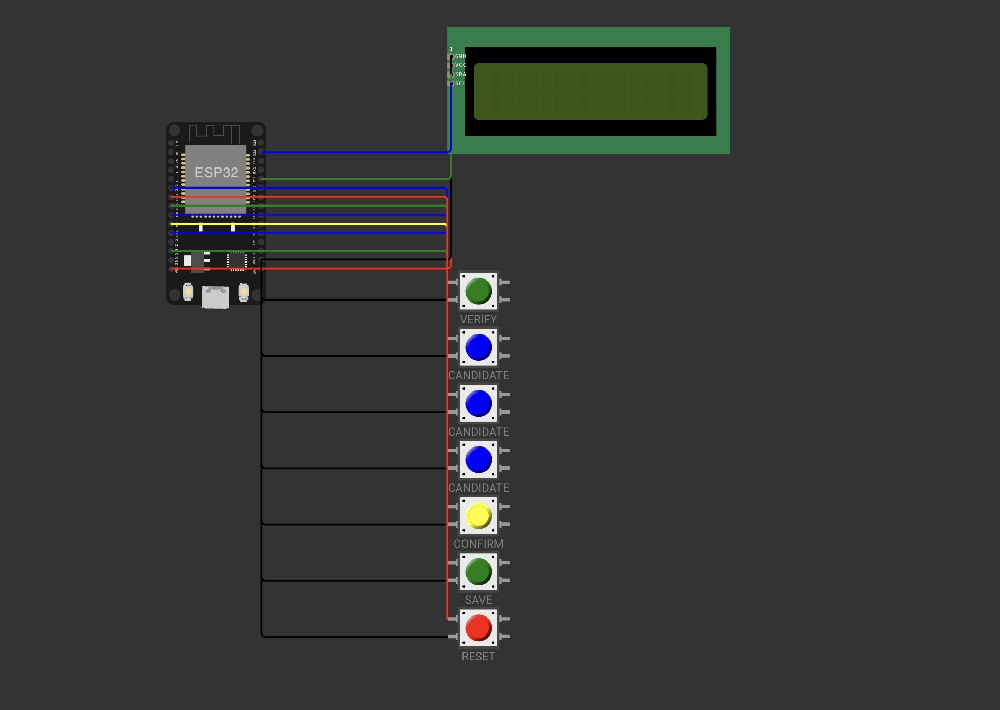

# Smart Biometric EVM — IoT Voting Simulation



A software-based **Smart Electronic Voting Machine (EVM)** prototype built using **ESP32, Arduino C++, Wokwi, an I²C LCD, virtual push buttons, and ThingSpeak**.

The project demonstrates a simulated voting workflow, voter ID validation, duplicate-vote prevention, local vote counting, and cloud-based publication of aggregate voting results.

> **Note:** This is an academic simulation. Fingerprint verification is simulated in software; no physical fingerprint sensor is connected. This prototype is not intended for real elections.

## Features

- Simulated biometric verification.
- Voter ID entry through the Serial Monitor.
- One-vote-per-voter-ID validation.
- Candidate selection using virtual buttons.
- I²C 16×2 LCD status display.
- Vote confirmation and saving.
- Receipt ID generation after saving a vote.
- Persistent vote records using ESP32 Preferences.
- Serial Monitor command for displaying results.
- Wi-Fi connectivity and ThingSpeak cloud integration.
- Cloud dashboard displaying total votes and candidate-wise counts.

## Technology Stack

| Technology | Purpose |
|---|---|
| ESP32 | Main microcontroller |
| Arduino C++ | Firmware development |
| Wokwi | Hardware simulation |
| I²C LCD 16×2 | Voting interface |
| Virtual Push Buttons | User input |
| ESP32 Preferences | Persistent local storage |
| Wi-Fi | Network connectivity |
| ThingSpeak | Cloud dashboard and IoT monitoring |

## System Workflow

1. Enter a unique voter ID in the Serial Monitor.
2. Press **VERIFY** to simulate biometric verification and check whether the voter has already voted.
3. Select Candidate A, B, or C.
4. Press **CONFIRM** to confirm the selection.
5. Press **SAVE** to store the vote and generate a receipt ID.
6. Press **RESET** to prepare the system for the next voter.
7. The ESP32 publishes aggregate voting statistics to ThingSpeak when a cloud update is due.

**Important:** Enter the voter ID through the Serial Monitor. The virtual buttons control the voting workflow but do not enter text.

## Hardware Pin Configuration

| Component | ESP32 GPIO |
|---|---|
| Verify Button | GPIO 13 |
| Candidate A Button | GPIO 14 |
| Candidate B Button | GPIO 26 |
| Candidate C Button | GPIO 32 |
| Confirm Button | GPIO 27 |
| Save Button | GPIO 25 |
| Reset Button | GPIO 33 |
| LCD SDA | GPIO 21 |
| LCD SCL | GPIO 22 |

All buttons use `INPUT_PULLUP` and are connected between their assigned GPIO pins and GND.

## Project Structure

```text
Smart-Biometric-EVM/
├── sketch.ino       # ESP32 firmware
├── diagram.json     # Wokwi circuit configuration
├── libraries.txt    # Required libraries
└── README.md        # Project documentation